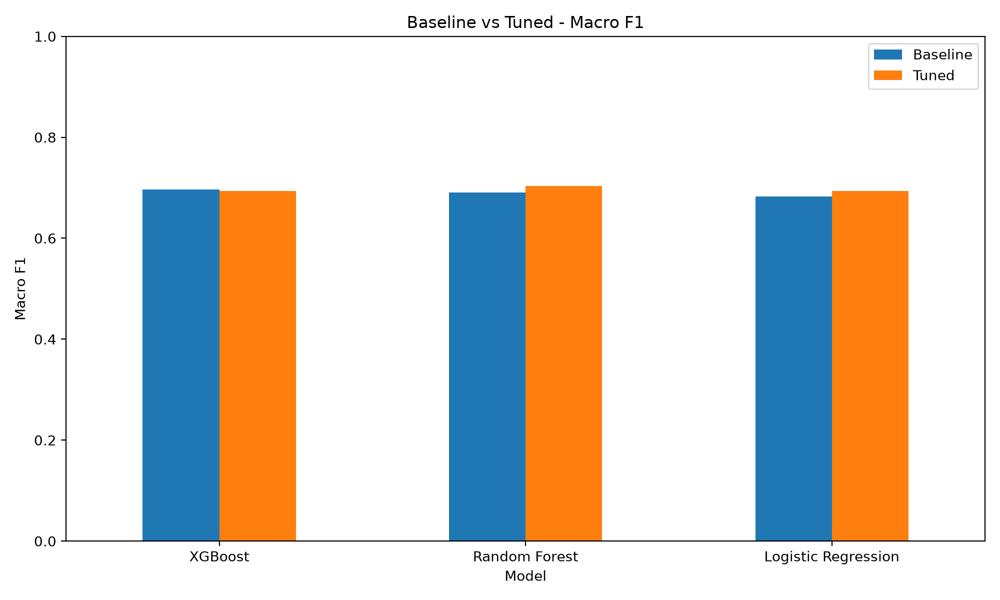
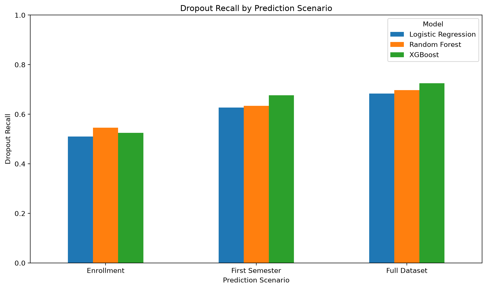
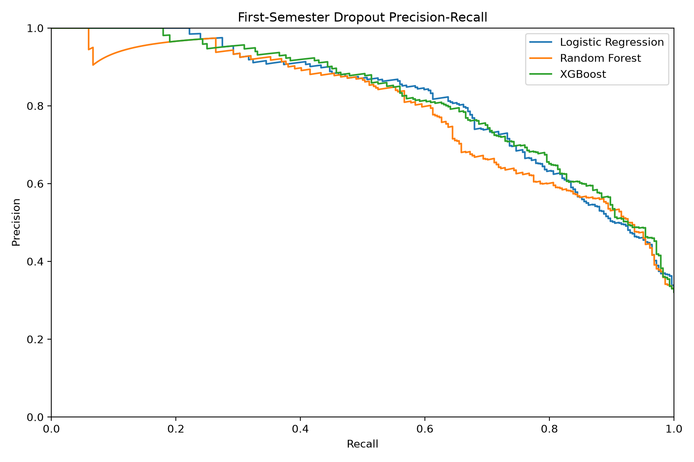

# Breaking Educational Barriers

## Student Dropout Risk Prediction Using Machine Learning

Machine Learning Term Project:
Learning for Breaking Barriers

## Project Overview

This project investigates whether machine
learning can identify students at risk of
dropping out and support earlier academic
intervention.

The objective is to reduce educational
barriers by identifying opportunities
to provide students with additional support.

## Research Questions

1. Can machine learning predict student outcomes?
2. Does hyperparameter optimization improve performance?
3. How early can dropout risk be identified?
4. Does performance differ across student groups?
5. How do probability thresholds affect intervention workload?

## Dataset

UCI Predict Students' Dropout and Academic Success

https://archive.ics.uci.edu/dataset/697/predict+students+dropout+and+academic+success

The dataset contains 4,424 students and
36 input features.

Target classes:

| Outcome | Students |
|---|---:|
| Graduate | 2,209 |
| Dropout | 1,421 |
| Enrolled | 794 |

The dataset is retrieved automatically
using the ucimlrepo Python package.

## Methodology

- Exploratory data analysis
- Missing-value and duplicate analysis
- Stratified 80/20 train-test split
- StandardScaler for Logistic Regression
- Target label encoding
- Baseline model training
- Five-fold cross-validation
- Grid and randomized hyperparameter searches
- Early prediction experiments
- Error and subgroup analysis
- Intervention threshold analysis

## Models

- Logistic Regression
- Random Forest
- XGBoost

Three baseline and three optimized
configurations were evaluated.

## Main Results

| Model | Accuracy | Macro F1 | Dropout Recall |
|---|---:|---:|---:|
| Baseline Logistic Regression | 76.84% | 68.26% | 76.76% |
| Baseline Random Forest | 76.84% | 69.02% | 74.30% |
| Baseline XGBoost | 76.16% | 69.64% | 74.30% |
| Tuned Logistic Regression | 72.99% | 69.36% | 68.31% |
| Tuned Random Forest | 74.69% | 70.34% | 69.72% |
| Tuned XGBoost | 76.16% | 69.39% | 72.54% |

Tuned Random Forest achieved the highest
macro F1, while baseline Logistic Regression
achieved the highest dropout recall.

## Project Structure

    ML_StudentDropoutRisk/
    ├── notebooks/
    │   ├── 01_data_imports.ipynb
    │   ├── 02_preprocessing.ipynb
    │   ├── 03_logistic_regression.ipynb
    │   ├── 04_random_forest.ipynb
    │   ├── 05_xgboost.ipynb
    │   ├── 06_error_analysis.ipynb
    │   └── 07_final_results.ipynb
    ├── results/
    ├── evaluate_baselines.py
    ├── tune_models.py
    ├── early_prediction.py
    ├── error_analysis.py
    ├── run_pipeline.py
    ├── app.py
    ├── MODEL_CARD.md
    ├── requirements.txt
    ├── requirements-portable.txt
    └── README.md

## Environment Setup

Python 3.12 is recommended.

Clone the repository:

    git clone https://github.com/jcastillo0220/ML_StudentDropoutRisk.git
    cd ML_StudentDropoutRisk

Create a virtual environment:

    python3.12 -m venv .venv

Activate on macOS or Linux:

    source .venv/bin/activate

Activate on Windows PowerShell:

    .venv\Scripts\Activate.ps1

Install dependencies:

    python -m pip install --upgrade pip
    python -m pip install -r requirements-portable.txt

macOS users may need the OpenMP runtime:

    brew install libomp

Register the Jupyter kernel:

    python -m ipykernel install --sys-prefix --name python3

## Reproduce All Results

Run the complete pipeline:

    python run_pipeline.py

The pipeline automatically retrieves data,
executes all seven notebooks, trains models,
performs hyperparameter optimization,
generates visualizations, and validates results.

Internet access is required for dataset retrieval.

Results are saved in the results directory.

Execution times may vary across systems.

## Interactive Dashboard

Launch:

    python -m streamlit run app.py --server.address 127.0.0.1

Open:

http://localhost:8501

Dashboard sections:

- Project Overview
- Model Comparison
- Early Prediction
- Error and Subgroup Analysis
- Intervention Simulator
- Limitations and Ethics

The dashboard uses aggregate experimental
results rather than individual student records.

## Key Visualizations

### Model Comparison

### Early Prediction

### Intervention Trade-off

## Responsible Use

The project is intended for academic research.
Predictions should support students rather
than restrict educational opportunities.

The experiments are retrospective and require
independent validation before deployment.

See [MODEL_CARD.md](MODEL_CARD.md) for additional
information about limitations, subgroup
performance, and ethical considerations.
